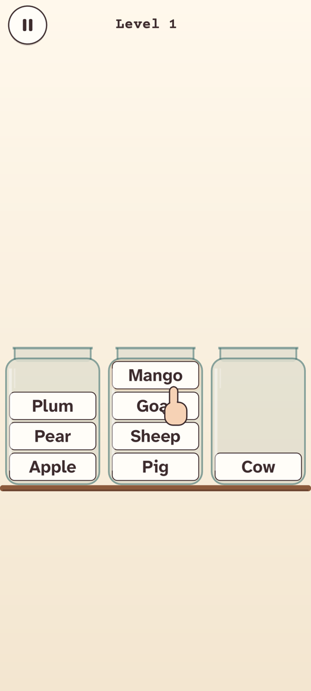
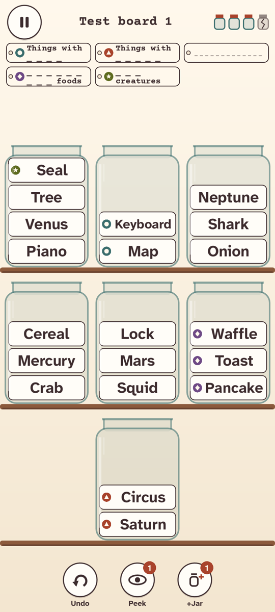
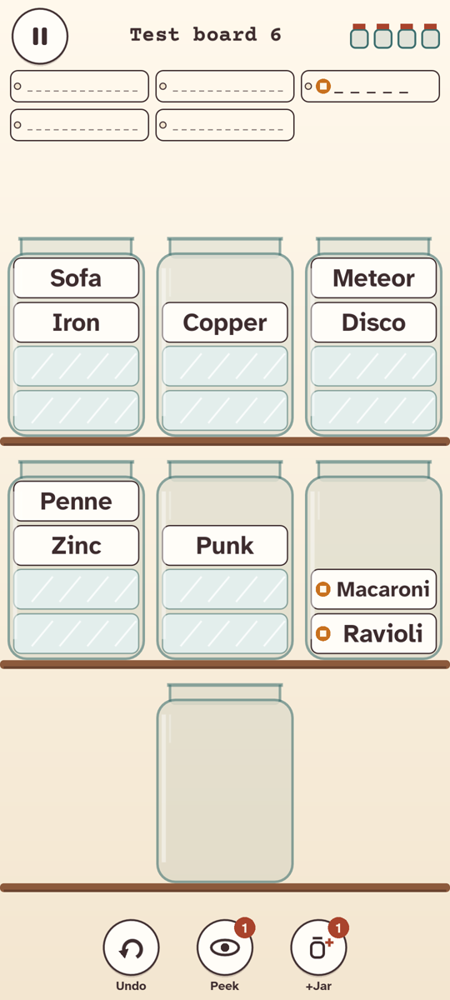
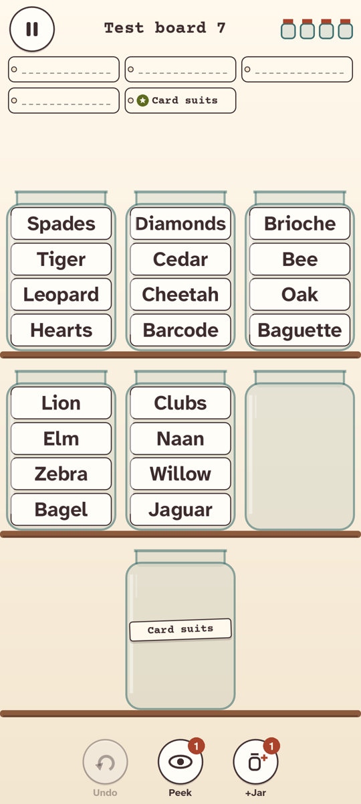

# Jarful

Sort word cards into glass jars by their hidden category. Only the top card moves, and a wrong drop bounces back
but gives away part of the label. Four cards that belong together get a lid, and the label types itself in.

*In development, built with Godot 4.7.2 for Android (portrait).* Design: [docs/DESIGN.md](docs/DESIGN.md).

## Status: M1 "find the fun" (v0.1.0)
- 10 tutorial levels and 8 mid-game test boards (5 groups, red herrings, frost, a labelled jar, a cork).
- A test menu (Pause → Test menu) with rule toggles, level select and a playtest log you can copy.
- Placeholder art and synthesised sounds. Home, the daily puzzle, coins and settings come in M2.

## Install the test build
1. Open the [latest pre-release](https://github.com/MehulKumars/jarful/releases) and download the `.apk` (arm64).
2. On the phone, allow installs from your browser or file manager, then open the APK.
3. It installs as **Jarful** (`com.mehulkumars.jarful`), next to the other games.

Over USB instead: `adb install -r jarful-0.1.0-arm64.apk`

## Build from source
See [CLAUDE.md](CLAUDE.md) for the commands (tests, level checks, bot sims, screenshots, export).

## Screenshots (M1 grey-box)

