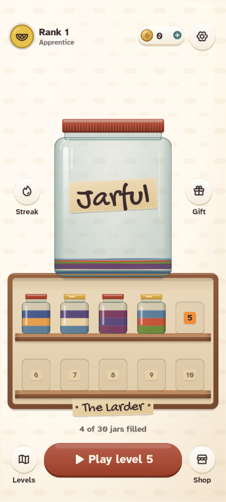
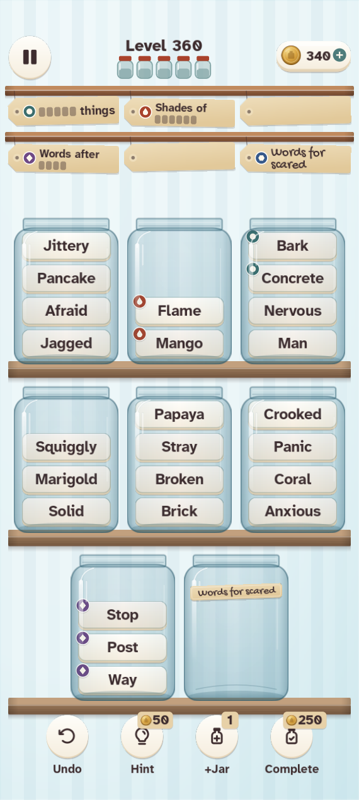
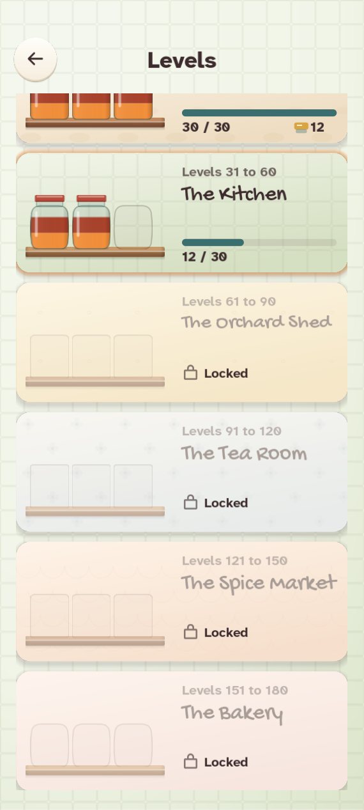
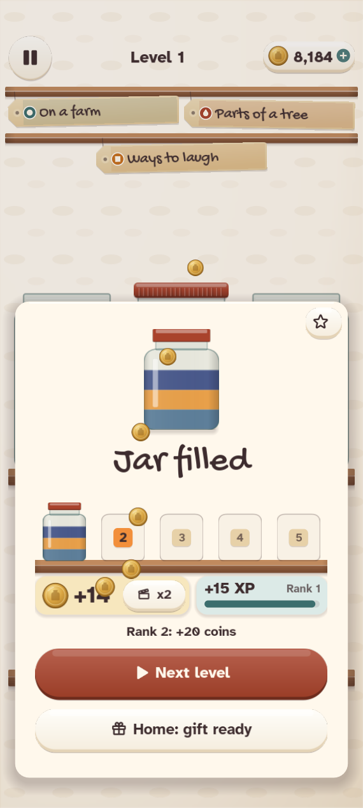

<p align="center"></p>

<h1 align="center">Label Hunt</h1>

<p align="center">
<b>A calm word-sorting puzzle.</b> Sort word cards into glass jars by their hidden category.<br>
Guess wrong and the jar gives away part of the label. Fill a jar and the lid screws on.
</p>

<p align="center">
<a href="https://github.com/MehulKumars/jarful/releases/latest"></a>
</p>

<p align="center">


</p>

<table align="center">
<tr>
<td></td>
<td></td>
<td></td>
<td></td>
</tr>
<tr>
<td align="center"><sub>Your pantry fills up</sub></td>
<td align="center"><sub>Sort by hidden category</sub></td>
<td align="center"><sub>17 rooms, each its own look</sub></td>
<td align="center"><sub>Every level is a jar</sub></td>
</tr>
</table>

## How to play
- **Tap a jar, then another**, to move its top card. Dragging works too. Only the top card of a jar can move.
- A card can go on an **empty jar** or on a card from **the same hidden group**.
- A wrong drop is a **slip**. The card bounces home, and the group's label on the rail moves one step on:
  blank → `Things with ▢▢▢▢` → the first letter → the full label.
- Your first **pair** in a group also moves its label on, so careful play earns hints for free.
- **Four of a kind** in one jar puts the lid on. Lids are permanent and always right.
- **Undo** and **+Jar** are free. From level 11 each level has a slip budget. If you run out, one tap retries.
- **Stars:** a win earns 1 to 3 stars by how few slips it took (Hints never cost a star). 3 stars is a gold lid.
- **Hint** (50 coins) shows a good next move. **Complete** (250 coins) seals a label you pick from the rail.

The full rules, the level pipeline and the roadmap are in the design doc: [docs/DESIGN.md](docs/DESIGN.md).

## New in 0.6
- **Jarful is now Label Hunt**, by Tiffin Games, and has a Google Play build (`com.tiffingames.labelhunt`) for
  internal and closed testing. That build has no Shop, diamonds or ads until real billing and AdMob are in.
- The store kit is in `docs/store/`: listing text, privacy policy, Play Console checklist, icon, feature graphic and
  screenshots.

## New in 0.5
- **Stars.** Every win earns 1 to 3 stars, counted from your slips and shown live beside the slip jars. Early rooms
  are generous; from the Greenhouse on, and again in the last four rooms, 3 stars asks for a cleaner sort. Help never
  costs a star. 3 stars puts a gold lid on the jar.
- **Coins come from stars.** Each star pays, more in harder rooms, and replaying a level for more stars pays the
  stars you add.
- **Diamonds**, a second currency: bought, or 5 from an optional ad in the Shop. They pay for a Hint (10), Continue
  (25) or Complete (40) when coins run short, and buy bundles. Coins are never sold.
- Stars on the shelves, on each room card ("★ 74/90") and on the Profile.

## New in 0.4
- **An easy first room.** Room 1 was re-made as an on-ramp: everyday categories first, then the slip limit,
  "Words after snow" groups and herrings, one idea at a time. Every word was checked for double meanings.
- **Peppers tell you how hard a level is:** one for tricky, two for hard, on the shelf and beside the title.
- **The Next button says what's next** ("Next: hard level"), and a room's last jars show the finish line.
- **A help ladder:** two fails give a free Hint and a slip; three also start the hardest label off. Always shown.
- A level interrupted under different rules starts fresh instead of rebuilding the wrong board.

## What's in 0.3
- **510 levels in 17 rooms of 30:** a medium start, then a long climb to very hard. New ideas arrive along the way:
  herrings, abstract categories, 5 and 6 groups, frosted, labelled and corked jars, and wordplay.
- **A look for each room:** its own walls, wood and jar shape, getting richer as you go.
- **Home, Levels map and room view:** the big jar and the pantry cabinet, plus a card for every room. Tap a solved
  level to replay it.
- **Coins and boosters:** earned from first solves, the daily gift, rank-ups and finished rooms, and harder rooms pay
  more. No energy, no timers, no forced ads, and Retry is always free.
- **Play streak and daily gift:** the gift opens after the day's first win and grows over 7 days, with bonuses at 10,
  15, 20 and 30 days and on from there. Streak savers cover a missed day.
- **Profile:** rank, XP, titles, avatars and a pantry ledger.
- **Exact resume:** a level interrupted when the app is killed picks up where it left off.

<details>
<summary><b>Known gaps</b></summary>

- Ads, diamond packs and friends are simulated. The real ones need AdMob, Play Billing and Play Games.
- Difficulty was tuned with bots and hasn't been calibrated against human players yet.
- Jar of the Day (the daily puzzle) and levels 511 to 720 are still to come.
</details>

## Install on Android
1. Open the [latest release](https://github.com/MehulKumars/jarful/releases/latest) while signed in to GitHub
   (the repo is private) and download the `.apk`.
2. Open it on the phone and allow installs from your browser or file manager.
3. It installs as **Label Hunt (test)** (`com.mehulkumars.jarful`, the same app as the old Jarful builds). New builds
   install over old ones and keep your progress. The Google Play version (`com.tiffingames.labelhunt`) is a separate app
   with its own progress, and has no Shop, diamonds or ads yet.

Over USB instead: `adb install -r labelhunt-test-0.6.0-alpha-arm64.apk`

Older builds are on the [releases page](https://github.com/MehulKumars/jarful/releases).

## Roadmap
| Milestone | Version | Contents | |
|---|---|---|---|
| M1 | v0.1 | Find the fun: grey-box board, rule toggles, bot players | ✅ |
| M2 | v0.2 | Home, tutorial, the first room's progression, the art and sound direction | ✅ |
| M3 | v0.3 | Coins, boosters, streak, profile, Levels map, room themes, 510 levels | 🧪 alpha |
| | v0.5 | Stars, coins per star, diamonds and the Shop | 🧪 alpha |
| | v0.6 | First Google Play testing build ("Label Hunt") | 🧪 internal testing |
| M4 | v1.0-rc | Real ads, billing and Play Games, Jar of the Day, polish, store kit | |

## How it's made
- **Engine:** Godot 4.7.2 and GDScript. The UI is built in code, and all art is SVG built in code and rasterised
  at the device's scale, so it stays sharp on any phone.
- **Levels are baked offline**, never generated on the phone. A generator picks categories from a hand-reviewed
  bank (769 so far) and deals each board. Every level is then checked:
  - exactly one way to sort the cards into its groups;
  - no other category hides three or more of its cards across its groups;
  - a solver proves it solvable, and following Hints alone wins it;
  - a human-like bot plays it hundreds of times to measure difficulty against the target curve.
- **Tests** run on [GUT](https://github.com/bitwes/Gut). All tooling is headless GDScript in [tools/](tools/).

## Build from source
You need Godot 4.7.2 (with Android export templates for an APK). From the repo root:

```bash
godot --path .                                   # run on desktop in a phone-shaped window
godot --headless --path . -s addons/gut/gut_cmdln.gd -gconfig=res://.gutconfig.json   # tests
godot --headless --path . --export-release "Android" build/jarful-arm64.apk           # APK (needs a keystore)
```

Level generation, checks, bot sims, screenshots and the APK audit each have a tool script.
[CLAUDE.md](CLAUDE.md) lists every command.

## Docs
| | |
|---|---|
| [docs/DESIGN.md](docs/DESIGN.md) | Rules, progression, difficulty pipeline, screens, art and feel, scope |
| [docs/plan-m3.md](docs/plan-m3.md) | The M3 plan: economy, boosters, streak, profile, rooms and levels |
| [docs/plan-m2.md](docs/plan-m2.md) | The M2 plan: Home, tutorial, the first room and the quality bar |
| [docs/research-ux.md](docs/research-ux.md) | Research on casual-puzzle UX (Home, onboarding, HUD, feel) that shaped M2 |
| [CREDITS.md](CREDITS.md) | Every third-party font, sound, icon and tool, with its licence |

## Credits
Fonts: Atkinson Hyperlegible Next and Gochi Hand (OFL). Icons: Phosphor (MIT). Sounds: Kenney and other CC0
authors on OpenGameArt. Music: "Catmint" by Kistol (CC0). Full list in [CREDITS.md](CREDITS.md).

Jarful's code, design and art are © 2026 Mehul Kumar. All rights reserved. Third-party assets keep their own
licences.
