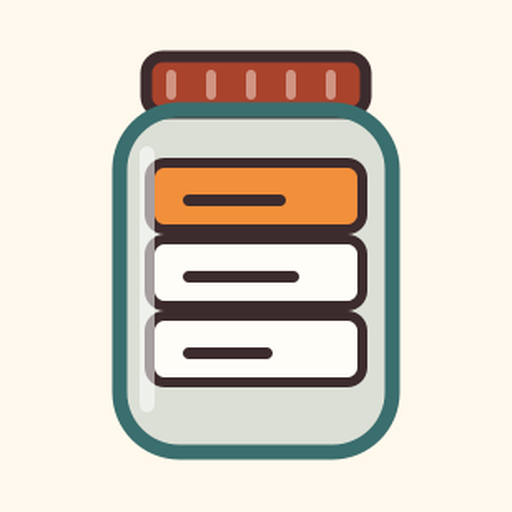
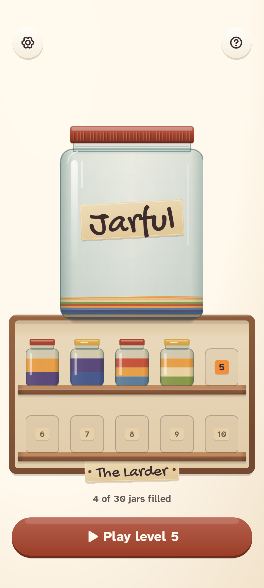
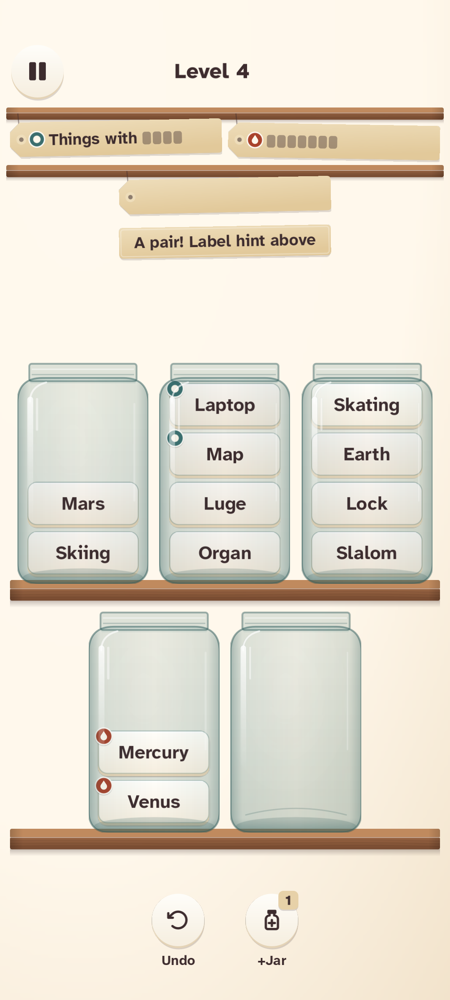
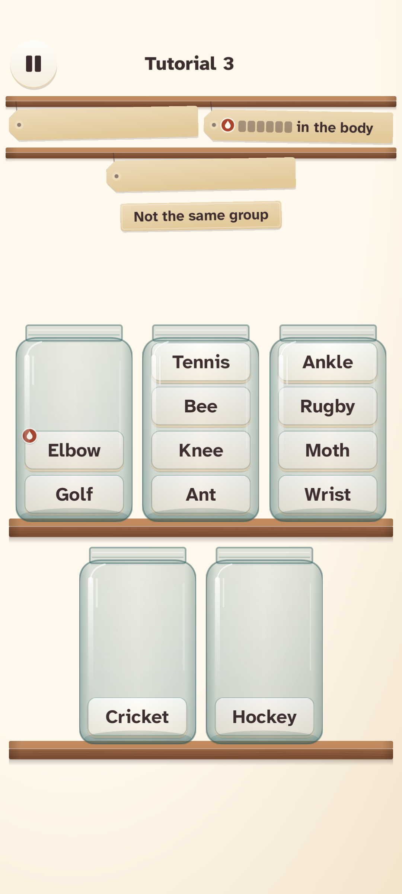
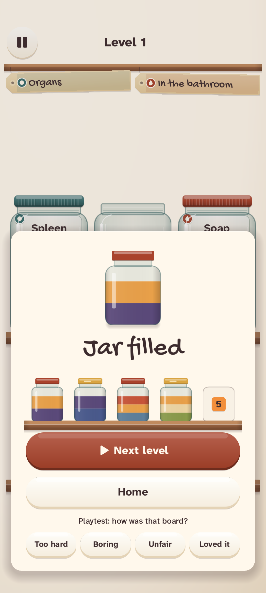

<p align="center"></p>

<h1 align="center">Jarful</h1>

<p align="center">
<b>A calm word-sorting puzzle.</b> Sort word cards into glass jars by their hidden category.<br>
Guess wrong and the jar gives away part of the label. Fill a jar and the lid screws on.
</p>

<p align="center">
<a href="https://github.com/MehulKumars/jarful/releases/latest"></a>
</p>

<p align="center">


</p>

<table align="center">
<tr>
<td></td>
<td></td>
<td></td>
<td></td>
</tr>
<tr>
<td align="center"><sub>Your pantry fills up</sub></td>
<td align="center"><sub>Sort by hidden category</sub></td>
<td align="center"><sub>A slip reveals the label</sub></td>
<td align="center"><sub>Every level is a jar</sub></td>
</tr>
</table>

## How to play
- **Tap a jar, then another**, to move its top card. Dragging works too. Only the top card of a jar can move.
- A card can go on an **empty jar** or on a card from **the same hidden group**.
- A wrong drop is a **slip**. The card bounces home, and the group's label on the rail moves one step on:
  blank → `Things with ▢▢▢▢` → the first letter → the full label.
- Your first **pair** in a group also moves its label on, so careful play earns hints for free.
- **Four of a kind** in one jar puts the lid on. Lids are permanent and always right.
- **Undo** is free. From level 11 each level has a slip budget. If you run out, one tap retries.

The full rules, the level pipeline and the roadmap are in the design doc: [docs/DESIGN.md](docs/DESIGN.md).

## What's in 0.2.0-alpha
- **Home:** a big jar that fills with a coloured layer for every category you solve, a pantry cabinet where each
  finished level becomes a little jar (gold lid for a clean sort), and one big **Play** button.
- **Tutorial:** three short boards on first launch, with **Skip** top right. **?** on Home replays it.
- **Room 1, "The Larder":** 30 levels that rise and dip in packs of ten. Slip budgets start at level 11,
  four groups at 16 and red herrings at 26.
- **Look and sound:** glass jars, paper cards, wooden shelves, enamel lids and hand-lettered labels, all drawn in
  code. Glass, wood and paper sounds plus a calm piano loop, all CC0. Haptics only on the moments that matter.
- **Settings:** sound, music, haptics, reduce motion, How to play and Credits.

<details>
<summary><b>Known gaps</b></summary>

- Killing the app mid-level restarts that level. Exact resume is next.
- The full room view (tapping the cabinet) isn't built yet.
- Jar of the Day and coins arrive in M2b.
</details>

## Install on Android
1. Open the [latest release](https://github.com/MehulKumars/jarful/releases/latest) while signed in to GitHub
   (the repo is private) and download the `.apk`.
2. Open it on the phone and allow installs from your browser or file manager.
3. It installs as **Jarful** (`com.mehulkumars.jarful`). New builds install over old ones and keep your progress.

Over USB instead: `adb install -r jarful-0.2.0-alpha-arm64.apk`

Older builds are on the [releases page](https://github.com/MehulKumars/jarful/releases).

## Roadmap
| Milestone | Version | Contents | |
|---|---|---|---|
| M1 | v0.1 | Find the fun: grey-box board, rule toggles, bot players | ✅ |
| M2 | v0.2 | Home, tutorial, Room 1 progression, the art and sound direction | 🧪 alpha |
| M2b | v0.2.x | Jar of the Day (daily puzzle with a streak) and coins/boosters | |
| M3a | v0.3 | Content: rooms 2–5 (150 levels), dailies | |
| M3b | v0.4 | Sound and music pass, remaining rooms' art, juice pass | |
| M4 | v1.0-rc | Polish, performance, store kit | |

## How it's made
- **Engine:** Godot 4.7.2 and GDScript. The UI is built in code, and all art is SVG built in code and rasterised
  at the device's scale, so it stays sharp on any phone.
- **Levels are baked offline**, never generated on the phone. A generator picks categories from a hand-reviewed
  bank (139 so far) and deals each board. Every level is then checked:
  - exactly one way to sort the cards into its groups;
  - no other category hides three or more of its cards;
  - a solver proves it solvable;
  - a human-like bot plays it hundreds of times to measure difficulty against the target curve.
- **Tests** run on [GUT](https://github.com/bitwes/Gut). All tooling is headless GDScript in [tools/](tools/).

## Build from source
You need Godot 4.7.2 (with Android export templates for an APK). From the repo root:

```bash
godot --path .                                   # run on desktop in a phone-shaped window
godot --headless --path . -s addons/gut/gut_cmdln.gd -gconfig=res://.gutconfig.json   # tests
godot --headless --path . --export-release "Android" build/jarful-arm64.apk           # APK (needs a keystore)
```

Level generation, checks, bot sims, screenshots and the APK audit each have a tool script.
[CLAUDE.md](CLAUDE.md) lists every command.

## Docs
| | |
|---|---|
| [docs/DESIGN.md](docs/DESIGN.md) | Rules, progression, difficulty pipeline, screens, art and feel, scope |
| [docs/plan-m2.md](docs/plan-m2.md) | The M2 plan: Home, tutorial, Room 1 and the quality bar |
| [docs/research-ux.md](docs/research-ux.md) | Research on casual-puzzle UX (Home, onboarding, HUD, feel) that shaped M2 |
| [CREDITS.md](CREDITS.md) | Every third-party font, sound, icon and tool, with its licence |

## Credits
Fonts: Atkinson Hyperlegible Next and Gochi Hand (OFL). Icons: Phosphor (MIT). Sounds: Kenney and other CC0
authors on OpenGameArt. Music: "Catmint" by Kistol (CC0). Full list in [CREDITS.md](CREDITS.md).

Jarful's code, design and art are © 2026 Mehul Kumar. All rights reserved. Third-party assets keep their own
licences.
